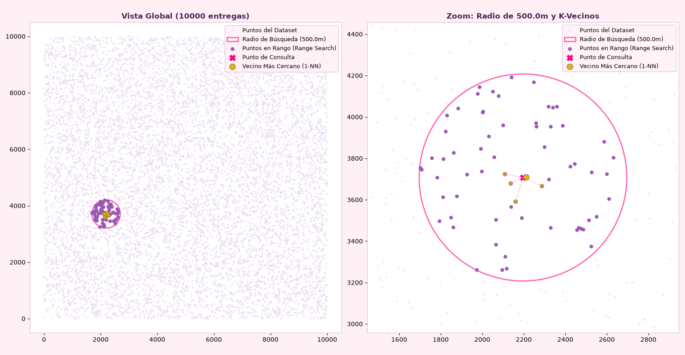
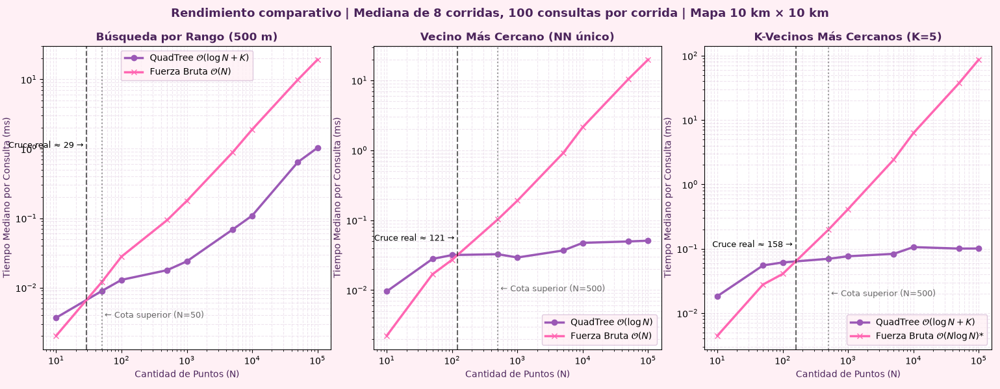
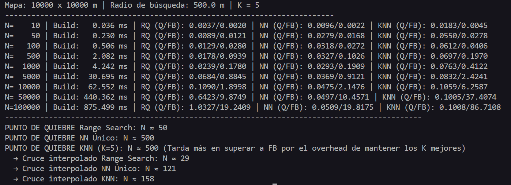

# Laboratorio: Implementación de Árbol QuadTree Bidimensional

**Estudiante:** Maria Camila Torres Chica

## Requisitos Generales del Entorno

* **Lenguaje:** Python 3.10 o superior.
* **Dependencias principales:** Módulos estándar de Python (`math`, `time`, `random`, `statistics`, `typing`), y `matplotlib` para la generación de gráficas y renderizado espacial.

### Ejecución

```bash
python test.py       # asserts + Figure_1
python analisis.py   # benchmark + Figure_2
```

## Archivos del Repositorio

| Archivo | Descripción |
| :--- | :--- |
| `Quadtree.py` | Implementación desde cero: `Point`, `BoundingBox`, `Node`, `QuadTree` (inserción, `range_search`, `nearest_neighbor`, `k_nearest_neighbors`). Solo usa `math` y `typing`. |
| `test.py` | Casos borde, pruebas de correctitud contra fuerza bruta (200 consultas) y verificación visual. |
| `analisis.py` | Benchmark (mediana de 8 corridas), cruces interpolados y gráficas de rendimiento. |
| `Gráficas/` | `Figure_1.png` (verificación visual), `Figure_2.png` (rendimiento), `Resultados_Análisis.png` (salida de consola del benchmark). |

## Descripción del Proyecto

En este proyecto se implementó desde cero un árbol **QuadTree bidimensional** para un sistema de logística de entregas en una ciudad. Se trabaja con las coordenadas de 10.000 puntos de entrega, que son estáticas (no cambian después de construir el árbol), y se compara qué tan rápido responde el árbol frente a la **fuerza bruta**, que consiste en recorrer la lista completa de puntos en cada consulta.

### Preguntas Logísticas Resueltas

El sistema está diseñado para responder eficientemente a tres requerimientos:

1. **Búsqueda por Rango (Range Search):** ¿Qué puntos de entrega están a un radio exacto de 500 metros desde un punto de consulta dado?
2. **Vecino Más Cercano (Nearest Neighbor):** ¿Cuál es el punto de entrega más cercano a una ubicación dada?
3. **K vecinos más cercanos (K-NN):** ¿cuáles es son los k puntos de entrega más cercanos a una ubicación dada?

## Diseño Algorítmico y Complejidad Espacial

### Supuestos y unidades

* Las coordenadas están en **metros**. El mapa es un cuadrado de **10.000 m × 10.000 m (10 km × 10 km)**, de modo que el radio de 500 m se usa directamente como `radius = 500.0`.
* Los datos son sintéticos: puntos con distribución **uniforme** en el mapa. En `test.py` se usan 10.000 puntos con semilla fija (`random.seed(42)`) para que los resultados sean reproducibles.
* Los datos son estáticos: no hay inserciones ni borrados después de construir el árbol.
* La implementación es en **2D**. Generalizar a $k$ dimensiones es directo ($2^k$ hijos por nodo y distancia sumada por eje), pero el número de hijos crece exponencialmente (4 en 2D, 8 en 3D, 1.024 en 10D) y, para $k$ alto, la poda deja de ser efectiva. Además, el problema es geográfico y se refleja de forma natural en 2D.

### 1. Construcción del Árbol QuadTree

El árbol se construye dividiendo recursivamente el espacio 2D en regiones. Cada nodo representa una caja delimitadora (*Bounding Box*). Cuando un nodo supera su capacidad máxima (4 puntos), el espacio se divide en cuatro cuadrantes (noroeste, noreste, suroeste, sureste). Esto permite organizar los puntos según su posición espacial. Se define una profundidad máxima (`MAX_DEPTH = 20`) para evitar recursión infinita cuando hay puntos duplicados.

### 2. Búsqueda en Radio $\mathcal{O}(\log N + K)$

Para encontrar puntos dentro del radio de 500m:

* Se calcula la intersección entre el círculo de búsqueda y la caja del nodo.
* Si una región está completamente fuera del radio, se poda (se ignora esa rama entera).
* Si el nodo es una hoja, se calcula la distancia de cada uno de sus puntos al centro del círculo y se guardan los que quedan dentro.
* *Complejidad Sensible a la Salida*: El tiempo depende logarítmicamente del total de datos ($N$), más un factor ($K$) proporcional a la cantidad de paquetes efectivamente encontrados dentro del radio.

### 3. Vecino Más Cercano $\mathcal{O}(\log N)$

Se realiza una búsqueda priorizando los cuadrantes que están geométricamente más cerca del punto de consulta. Se mantiene un registro de la distancia del "campeón" actual, lo que permite descartar rápidamente cuadrantes cuya distancia mínima a la consulta sea mayor que la distancia del campeón encontrado.

### 4. K Vecinos Más Cercanos $\mathcal{O}(\log N + K)$

Misma idea que el vecino más cercano, pero se mantienen los K mejores candidatos: un cuadrante se descarta solo si su distancia mínima supera la del *peor* de los K candidatos actuales. Devuelve los puntos ordenados por cercanía.

---

> Las complejidades son de **caso promedio con datos uniformes**; en el peor caso (datos muy concentrados) el árbol puede degradarse hacia $\mathcal{O}(N)$.

## Pruebas de Correctitud y Verificación Visual

`test.py` valida el QuadTree contra la fuerza bruta:

* **Casos borde:** árbol vacío (1-NN devuelve `None`; K-NN y rango devuelven lista vacía), radio 0, consulta fuera del mapa y 10 puntos duplicados.
* **Correctitud:** 200 consultas aleatorias sobre 10.000 puntos. En cada una se compara el QuadTree con la fuerza bruta: mismo **conjunto** de puntos en rango, mismas coordenadas en 1-NN, y mismos puntos y en el mismo orden en K-NN (K = 5). Todos los asserts pasan.

### Verificación Visual de Consultas Espaciales

*(A la izquierda: mapeo de 10.000 entregas y la zona de consulta. A la derecha: ampliación al radio de 500 m).*


## Análisis de Rendimiento (Benchmarking)

Para garantizar resultados rigurosos, se realizaron pruebas de estrés escalando el tamaño del conjunto de datos en una escala logarítmica: $N \in \{10, 50, 100, 500, 1.000, 5.000, 10.000, 50.000, 100.000\}$. En cada $N$ se hicieron **8 corridas** (con puntos y consultas nuevos), cada una con **100 consultas** aleatorias; se reporta la **mediana** del tiempo promedio por consulta, para reducir el ruido de una sola medición. Ambos enfoques están escritos en Python puro, de modo que la comparación mide el efecto de la estructura.

*(Curvas de tiempo promedio: QuadTree vs Fuerza Bruta. Escala log-log para comparar complejidad $\mathcal{O}(\log N)$ vs $\mathcal{O}(N)$. El asterisco en la leyenda del panel de K-NN se explica en la nota debajo de la tabla de resultados).*


### Punto de quiebre

A partir de los experimentos realizados, se determinó que **el QuadTree empieza a ser más rápido que la fuerza bruta desde unas decenas hasta pocos cientos de puntos**, según la consulta. El *cruce real* se obtiene interpolando en escala log-log entre los dos puntos de la grilla que lo contienen, y la *cota superior* es el primer $N$ probado donde el QuadTree ya gana.

| Consulta | Cota superior (grilla) | Cruce interpolado |
| :--- | ---: | ---: |
| Búsqueda por rango (500 m) | N = 50 | **N ≈ 29** |
| Vecino más cercano | N = 500 | **N ≈ 121** |
| K vecinos más cercanos (K = 5) | N = 500 | **N ≈ 158** |

* En $N = 10$, la fuerza bruta es más rápida en las tres consultas (en rango: $0.0020\text{ ms}$ vs $0.0037\text{ ms}$) porque recorrer una lista muy corta con un bucle simple cuesta menos que el sobrecosto del QuadTree (llamadas recursivas, evaluación de cajas delimitadoras).
* **En rango, en $N = 50$** ya ocurre el cruce: el QuadTree ($0.0089\text{ ms}$) supera a la fuerza bruta ($0.0121\text{ ms}$).
* **En vecinos más cercanos** el cruce llega más tarde: en $N = 100$ el QuadTree todavía pierde en NN ($0.0318\text{ ms}$ vs $0.0272\text{ ms}$) y gana claramente en $N = 500$ ($0.0327\text{ ms}$ vs $0.1026\text{ ms}$). A partir de ahí, el ahorro de tiempo generado por la poda espacial compensa el costo estructural del árbol.

### Resultados (tiempo mediano por consulta, ms)

| N | Build | Rango Quad / FB | NN Quad / FB | K-NN Quad / FB\* |
| ---: | ---: | :---: | :---: | :---: |
| 10 | 0.036 | 0.0037 / 0.0020 | 0.0096 / 0.0022 | 0.0183 / 0.0045 |
| 50 | 0.230 | 0.0089 / 0.0121 | 0.0279 / 0.0168 | 0.0550 / 0.0278 |
| 100 | 0.506 | 0.0129 / 0.0280 | 0.0318 / 0.0272 | 0.0612 / 0.0406 |
| 500 | 2.082 | 0.0178 / 0.0939 | 0.0327 / 0.1026 | 0.0697 / 0.1970 |
| 1.000 | 4.242 | 0.0239 / 0.1780 | 0.0293 / 0.1909 | 0.0763 / 0.4122 |
| 5.000 | 30.695 | 0.0684 / 0.8845 | 0.0369 / 0.9121 | 0.0832 / 2.4241 |
| **10.000** | **62.552** | **0.1090 / 1.8998** | **0.0475 / 2.1476** | **0.1059 / 6.2587** |
| 50.000 | 440.362 | 0.6423 / 9.8749 | 0.0497 / 10.4571 | 0.1005 / 37.4074 |
| 100.000 | 875.499 | 1.0327 / 19.2409 | 0.0509 / 19.8175 | 0.1008 / 86.7108 |

*(Quad = QuadTree, FB = fuerza bruta, Build = tiempo de construcción del árbol).*

\* La fuerza bruta de K-NN ordena todas las distancias ($\mathcal{O}(N \log N)$), por lo que las aceleraciones de K-NN son una cota superior. El baseline óptimo sería $\mathcal{O}(N)$ con un heap de tamaño $K$.

*(Registro en consola del benchmarking, con el detalle de cota superior y cruce interpolado).*


### Desempeño a Escala Logística ($N = 10.000$)

A medida que el número de puntos aumenta, la fuerza bruta se vuelve insostenible debido a su naturaleza $\mathcal{O}(N)$. En la escala de 10.000 entregas:

* En la **consulta de rango**, la fuerza bruta tarda $1.8998\text{ ms}$ por consulta, mientras que el **QuadTree** se mantiene en apenas $0.1090\text{ ms}$: una aceleración de **≈ 17×**.
* En el **vecino más cercano**: $2.1476\text{ ms}$ contra $0.0475\text{ ms}$, **≈ 45×**.
* En **K-NN (K = 5):** $6.2587\text{ ms}$ contra $0.1059\text{ ms}$, **≈ 59×**\*.

### Costo de construcción

Construir el árbol cuesta $62.55\text{ ms}$ para 10.000 puntos y $875\text{ ms}$ para 100.000 (≈ 14× más con 10× puntos, consistente con $\mathcal{O}(N \log N)$). Con 10.000 puntos, cada consulta ahorra entre ≈ 1.8 ms (rango) y ≈ 2.1 ms (NN), por lo que el árbol se paga solo tras **≈ 30-35 consultas**.

### Limitaciones

* **Baseline de K-NN:** la fuerza bruta ordena todo en lugar de usar una selección $\mathcal{O}(N)$ (por ejemplo, con un heap), así que las aceleraciones de K-NN son una cota superior. Las de rango y vecino más cercano usan baselines $\mathcal{O}(N)$.
* **Datos uniformes:** con datos muy concentrados en algunas zonas, el árbol se vuelve más profundo y la ventaja en rango se reduce, porque el radio atrapa muchos más puntos. No se evaluó en este laboratorio.
* **Dependencia de la máquina:** los tiempos absolutos y los cruces dependen del hardware y de Python; lo que se mantiene es la forma de las curvas. Con tiempos del orden de microsegundos, el cruce exacto varía entre corridas, por eso se reporta como un rango.
* **Capacidad de nodo:** se dejó en 4 y no se optimizó.

## Conclusión

El QuadTree es una estructura adecuada para consultas espaciales en dos dimensiones. Su construcción tiene un costo inicial de $62.55\text{ ms}$ para 10.000 puntos, pero este costo único se compensa cuando se realizan múltiples consultas (≈ 30-35). Aunque la fuerza bruta es suficiente para conjuntos pequeños (de unas decenas a pocos cientos de puntos), el QuadTree es claramente superior para sistemas de logística con volúmenes de datos urbanos: a 10.000 puntos responde entre ≈ 17× (rango) y ≈ 45× (vecino más cercano) más rápido.

## Notas aclaratorias

Durante el desarrollo de este laboratorio se usarón herramientas de inteligencia artificial (Claude (Sonnet 5.5) y Qwen3.7-plus) como apoyo para:

* consultar conceptos
* verificar implementaciones
* revisar la redacción y la interpretación de los resultados
* código de gráficación

Los resultados reportados provienen de la ejecución de `test.py` y `analisis.py`, incluidos en este repositorio.
